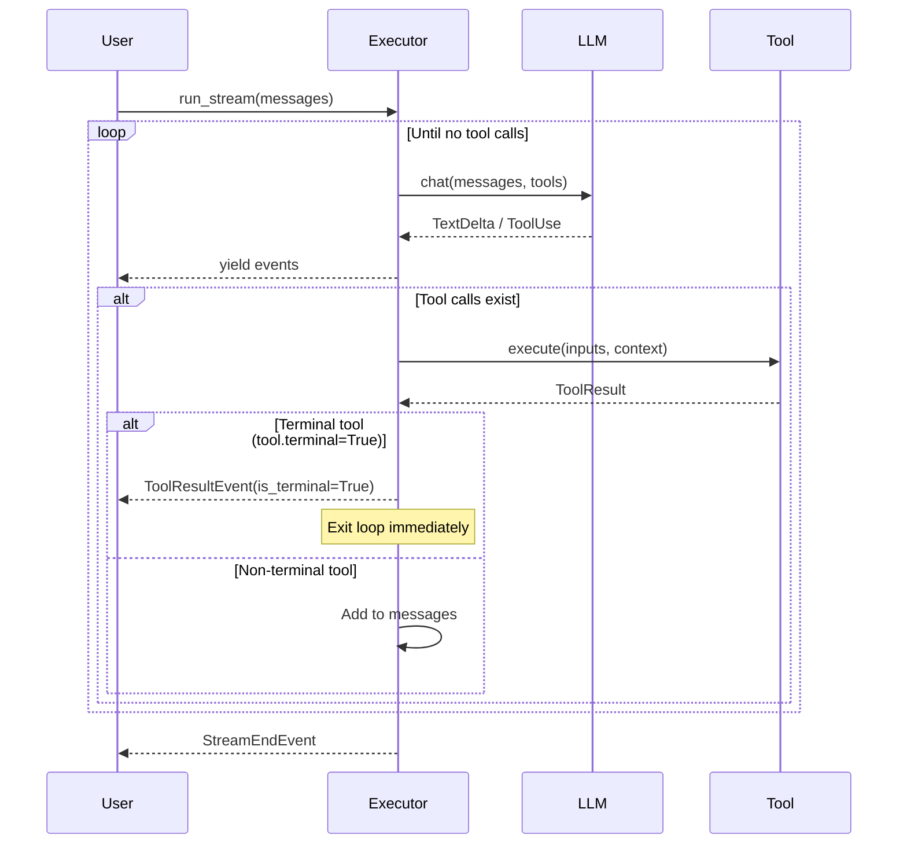

# AgentExecutor

`AgentExecutor` manages the agentic loop: send messages → LLM responds with tool calls → execute tools → repeat until done.

## Basic Usage

```python
from dobby import AgentExecutor, OpenAIProvider, Tool

executor = AgentExecutor(
    provider="openai",
    llm=OpenAIProvider(model="gpt-4o"),
    tools=[MyTool()],
)

async for event in executor.run_stream(messages, system_prompt="You are helpful."):
    match event.type:
        case "text-delta":
            print(event.delta, end="")
        case "tool-use":
            print(f"\n[Tool: {event.name}]")
```

---

## Initialization

```python
executor = AgentExecutor(
    provider="openai",           # "openai" | "azure-openai" | "anthropic" | "gemini" | "vertexai"
    llm=provider,                # Provider instance
    tools=[Tool1(), Tool2()],    # Optional tools
    output_type=MyOutputModel,   # Optional structured output
    output_mode="tool",          # "tool" | "native"
)
```

| Parameter | Type | Description |
|-----------|------|-------------|
| `provider` | `str` | Fallback tool-schema format. Used only when `llm.format_tools()` returns `None` |
| `llm` | `OpenAIProvider` | LLM provider instance |
| `tools` | `list[Tool]` | Available tools |
| `output_type` | `type[BaseModel]` | Pydantic model for structured output |
| `output_mode` | `str` | How to get structured output |

The `provider` literal picks a tool-schema shape, not a provider identity. A provider can decide the shape itself through `format_tools(tools)`: when it returns a list, the executor sends that list instead. `VertexAIProvider` does this, so `AgentExecutor("vertexai", provider)` sends Gemini, Anthropic or Chat Completions tools depending on the instance's route. Providers that return `None`, and duck-typed providers that lack the method, keep the literal's format.

### Accessing Registered Tools

```python
# Get all tools as dict[name, Tool]
executor.tools

# Get tool names
list(executor.tools.keys())  # ['search', 'fetch_data', ...]

# Get a specific tool
executor.tools['search']
```

---

## run_stream()

```python
async for event in executor.run_stream(
    messages,                    # Conversation history
    system_prompt="...",         # Optional system prompt
    context=my_context,          # Passed to Injected[T] tools
    max_iterations=10,           # Max tool call loops
    reasoning_effort="medium",   # For o1/o3 models
    approved_tool_calls=set(),   # Pre-approved tool call IDs
    max_model_corrections=3,     # Run-wide model-correction budget
):
    ...
```

`max_model_corrections` is a single run-wide budget (default `3`) shared by tool-call correction and final-result correction. When it is exhausted, `run_stream()` raises `ModelRetryExhaustedError`.

Tool errors in `ToolResultEvent.result` and conversation history are classified strings of the form `[error_code] message`, not `{"error": ...}`. Host-side `error_details` (`ToolErrorDetails`) still holds exception diagnostics, including the **full exception traceback**. Do not send `error_details` (especially `traceback`) to untrusted clients such as browsers.

Approval is host control flow, not a classified model error. The executor still emits a `ToolResultEvent` with `is_error=True` and `result={"approval_required": True}` so history does not look like the tool succeeded, then re-raises `ApprovalRequired`. Remaining unexecuted calls in that batch get the same placeholder dict. Already-running parallel calls may still complete successfully.

Host cancellation re-raises `asyncio.CancelledError` and does not yield `{"cancelled": True}` placeholders. A single in-flight call, a streaming or terminal call, and a parallel `asyncio.gather` batch surface that error from the in-flight read: parallel cancellation escapes `gather` before any per-call placeholders are assembled. In a sequential multi-tool batch, earlier successful events may already have been yielded before a later call is cancelled, so stopping consumption after one of those earlier events can prevent the later cancellation from being observed.

`dobby.exceptions` also exports the classification helpers the executor uses: `classify_tool_error`, `format_model_error`, and `ErrorDecision`. `classify_tool_error(exception)` returns an `ErrorDecision` (`code`, `model_message`, `retry_model`) or `None` for approval, cancellation, and other non-error control flow. `format_model_error(decision)` produces the `[error_code] message` string sent to the model.

### History shape

Each tool turn enters the executor's working history as two messages:

1. One `AssistantMessagePart` holding every part of the turn's `StreamEndEvent`, unchanged: reasoning, text and all tool calls.
2. One `UserMessagePart` holding every `ToolResultPart`, in the order the model made the calls.

Events and their order are unchanged. The executor used to split a turn into one assistant/user pair per call and drop the turn's reasoning and text. That shape showed the model one call per turn, which teaches it to stop calling tools in parallel, and it dropped reasoning that some providers require to be replayed.

Hosts that persist history between runs should store it the same way: `StreamEndEvent.parts` as one assistant message and all of the turn's results as one user message. Split-shape histories from older hosts are still accepted. One exception: Claude with thinking enabled must see the previous turn's thinking blocks, so a stored history without `ReasoningPart`s can return a 400 on a native Claude route.

---

## Event Types

The executor yields all provider events plus tool events:

| Event | Description |
|-------|-------------|
| `StreamStartEvent` | Stream started |
| `TextDeltaEvent` | Text chunk |
| `ReasoningDeltaEvent` | Reasoning chunk |
| `ToolUseEvent` | Tool call from LLM |
| `ToolStreamEvent` | Progress from streaming tool |
| `ToolResultEvent` | Tool execution result (check `is_terminal` for terminal tools) |
| `ToolUseEndEvent` | Tool finished |
| `StreamEndEvent` | Stream/iteration finished |

> For terminal tools that exit the loop, see [Terminal Tools](./tools/creating-tools.md#terminal-tools).

---

## Agentic Loop



---

## Structured Output

Force LLM to return structured data:

```python
from pydantic import BaseModel

class WeatherResponse(BaseModel):
    city: str
    temperature: float
    conditions: str

executor = AgentExecutor(
    provider="openai",
    llm=provider,
    output_type=WeatherResponse,
    output_mode="tool",  # Uses tool call to get structured output
)

async for event in executor.run_stream(messages):
    if event.type == "stream-end":
        # Find the final_result tool call
        for part in event.parts:
            if isinstance(part, ToolUsePart) and part.name == "final_result":
                result = WeatherResponse(**part.inputs)
                print(result)
```

---

## Context Injection

Pass runtime context to tools:

```python
@dataclass
class AppContext:
    db: Database
    user_id: str

context = AppContext(db=db, user_id="123")

async for event in executor.run_stream(
    messages,
    context=context,
):
    ...
```

Tools receive context via `Injected[T]`:

```python
@dataclass
class DBTool(Tool):
    async def __call__(
        self,
        ctx: Injected[AppContext],
        query: str,
    ) -> list:
        return await ctx.db.query(query)
```

---

## Tool Approval

For sensitive tools, require pre-approval:

```python
async for event in executor.run_stream(
    messages,
    approved_tool_calls={"call_abc"},
):
    if event.type == "tool-use":
        if event.id not in approved_tool_calls:
            # Pause and ask user for approval
            pass
```

If the tool is not in `approved_tool_calls`, the executor yields a `ToolResultEvent` with `is_error=True` and `result={"approval_required": True}` for that call, then raises `ApprovalRequired`. Remaining unexecuted calls get the same `{"approval_required": True}` placeholder (`is_error=True`). Already-running parallel calls may still complete successfully.

**Gemini tool-call IDs and approval.** Gemini often returns calls without IDs, so Gemini providers (`GeminiProvider` and `VertexAIProvider`'s Gemini route) mint `call_{name}`, then `call_{name}_2`, `call_{name}_3`, … when the ID is taken. An ID is taken when it is used earlier in the same response, or in the history by a call that has a real result. A call answered only by an `approval_required` or `cancelled` placeholder does not take its ID. So when you resume after approval, the regenerated call gets the same ID and matches `approved_tool_calls`, while a later, separate call to the same tool gets a new ID and cannot reuse the earlier approval.

Host cancellation re-raises `asyncio.CancelledError` and does not yield `{"cancelled": True}` placeholder events. A cancelled parallel batch in particular emits no per-call placeholders.
