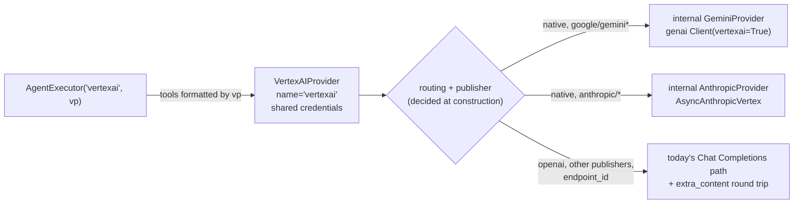

# feat: Native Vertex routing and tool-turn batching

## Summary

`VertexAIProvider` becomes a router. `google/gemini-*` models go to Gemini's native API and
`anthropic/*` models go to Anthropic's Messages API on Vertex, by default. All other
publishers and self-deployed endpoints stay on today's OpenAI-compatible route. The two native
routes reuse Dobby's existing Gemini and Anthropic converters, and all three routes share one
credential setup. The `VertexAIProvider` constructor and the `AgentExecutor("vertexai", ...)`
wiring stay the same for callers. The exceptions are the Breaking items in U8, such as string
`reasoning_effort` on Claude and OpenAI-only kwargs on native routes. In the same change, the executor stops splitting a parallel tool turn
into one message per call. Gemini tool-call IDs become unique. The OpenAI-compatible route keeps
Gemini thought signatures. `GeminiProvider` works through `AgentExecutor` again.

---

## Problem Frame

Today every Vertex model family goes through Vertex's OpenAI-compatible `endpoints/openapi`
Chat Completions surface. Dobby converts to OpenAI Chat format and Google converts again on its
side. Along the way Gemini thought signatures are dropped, which makes Gemini 3 tool calls fail
with 400. Claude thinking, prompt caching and `is_error` on tool results are lost, and Google
does not document Claude on that endpoint. Separately, the executor writes each parallel tool
turn back as one assistant/user pair per call and drops reasoning and text. This teaches models
to stop making parallel calls, which adds round trips on every provider.

The research for this plan compared LiteLLM, pydantic-ai, LangChain, Hermes and the OpenAI
Agents SDK. All of them keep a model turn whole in history. All except Hermes (which has no
Claude-on-Vertex route) send Gemini and Claude on Vertex through their native protocols. Only
LiteLLM offers a single Vertex entry point that routes by model ID. That is the shape chosen
here. The diagrams are in `docs/vertex-routing-options.md`.

Decisions taken with the user before planning:
- **Entry point:** a single `VertexAIProvider` that routes by publisher. The executor sees one
  provider; the native SDK does the native part.
- **Rollout:** native routing is the default immediately. `routing="openai"` brings back today's
  behaviour. This is a breaking release and is documented as one.

---

## Requirements

**Tool-turn history**
- R1. A model turn that contains tool calls goes into the executor's working history as **one**
  assistant message holding every part the adapter returned in `StreamEndEvent.parts`,
  unchanged (reasoning, text and all tool calls). It is followed by **one** user message holding
  every tool result, including skipped, approval and cancellation placeholders, in tool-call
  emission order. Each call gets exactly one result, even when calls share an ID or have none.
  Each signed thinking block the adapter returns keeps its own signature (no merging).
- R2. Public formats do not change: event types and their order, input `MessagePart` types, and
  acceptance of existing client histories in either the split or the batched shape.

**Gemini**
- R3. `GeminiProvider` works through `AgentExecutor`. `reasoning_effort` is accepted: `None`,
  an `int` thinking budget, or a `str` thinking level.
- R4. A Gemini tool call that arrives without an ID still gets `call_{name}`, as today, unless
  that ID is already taken. Taken means used earlier in the same response, or used in the
  request history by a call that has a real result (not only an approval or cancellation
  placeholder). A taken ID gets a numeric suffix (`call_{name}_2`, `call_{name}_3`, …). A
  resumed paused call therefore keeps its ID and still matches `approved_tool_calls`.
- R4b. On the native Gemini route and on `GeminiProvider`, a 429 from `google-genai` is
  retried as `RateLimitError`, and network timeouts or connection failures are retried as
  `APITimeoutError` or `APIConnectionError`, matching the other providers.

**Vertex routing**
- R5. By default, `VertexAIProvider` sends `google/gemini-*` models over the native Gemini API
  and `anthropic/*` models over the Anthropic Messages API on Vertex.
- R6. Every other publisher, and every `endpoint_id` instance, stays on today's route with
  today's request shape. The only differences are the history batching (R1) and the
  thought-signature round trip (R11), which apply on every route.
- R7. `routing="openai"` brings back today's route for all models. R1 and R11 still apply on
  it; they are fixes, not part of the routing change.
- R8. All routes share the credentials, project and location the provider already resolves.
  Callers configure nothing new.
- R9. The native routes reuse the existing Gemini and Anthropic converters and adapters. No
  converter is copied.
- R10. `AgentExecutor("vertexai", VertexAIProvider(...))` works for every route without
  changing how it is constructed, and sends tools in the format the active route expects.
  Callers of `VertexAIProvider.chat()` directly get the same format from a public
  `provider.format_tools(tools)`.
- R10b. Chat-Completions-only kwargs (at least `extra_body`, `stop`, `n`, `logprobs`,
  `response_format`, `seed`) passed on a native route raise `TypeError` before any network call.
  The message names the kwarg, the active route, and `routing="openai"`.
- R11. On the OpenAI-compatible route, `tool_calls[].extra_content` (Gemini thought signatures)
  is read from responses, streaming and non-streaming, and sent back unchanged.

**Release**
- R12. Every behaviour change visible to existing `VertexAIProvider` callers is listed under
  Breaking in `CHANGELOG.md`, together with the `routing="openai"` way back.

---

## Scope Boundaries

- Clients' stored histories in the old split shape are not regrouped. No surveyed library does
  this, because a split turn cannot be told apart from genuinely separate turns.
- No new public provider classes. Native Vertex is reached only through `VertexAIProvider`.
- No new model allowlist. Routing reads the publisher; it does not validate model names. This
  keeps the provider's rule of no stale client-side validation.
- No translation of `reasoning_effort` strings into Claude budgets. Values are not normalised
  across protocols.

### Deferred to Follow-Up Work

- Exposing the run's batched history to hosts (e.g. `executor.last_messages`, like
  pydantic-ai's `all_messages()`): additive, separate PR.
- Repairing history before each request (fill in calls with no result, drop orphaned
  results): separate PR.
- Prompt caching (`cache_control`) on the Anthropic and Gemini routes: separate PR.
- OpenAI Responses reasoning replay (`include=["reasoning.encrypted_content"]`): separate PR.
- Running other tools alongside a `final_result` call (pydantic-ai's `end_strategy`):
  separate PR.
- Native routes for Mistral, Codestral and AI21 on Vertex (LiteLLM has them): later, on demand.
- A region override per vendor, for projects where Claude and Gemini need different locations:
  later, on demand. For now a mismatch surfaces as Vertex's own error.
- Gemini thought summaries (`include_thoughts=True`): needs the Gemini parser to map
  `part.thought` parts to `ReasoningPart` first. Separate PR.
- Setting `routing` from an environment variable, so a deployed service can roll back without a
  code change: on demand.

---

## Context & Research

### Relevant Code and Patterns

- `dobby/executor.py`:
  - `_emit_tool_result` appends one `AssistantMessagePart` (bare `ToolUsePart`) and one
    `UserMessagePart` per call. This is the split this plan removes.
  - `_run_stream` collects calls from `StreamEndEvent.parts` but discards that list's other
    parts.
  - `get_tools_schema` picks the tool format from the `provider` literal.
- `dobby/providers/vertexai/adapter.py`:
  - Credential resolution (explicit, `GOOGLE_APPLICATION_CREDENTIALS_JSON`, ADC).
  - `_bearer_token` refreshes under a lock.
  - `_EndpointTarget` splits Model Garden from self-deployed endpoints.
  - `chat()` forwards `**kwargs`.
- `dobby/providers/vertexai/converters.py`: `to_vertexai_messages` (drops `ReasoningPart`) and
  `to_vertexai_tool`.
- `dobby/providers/gemini/adapter.py`:
  - `genai.Client(api_key=...)` only.
  - `chat()` forwards leftover kwargs into `GenerateContentConfig`, which forbids extra fields.
    `reasoning_effort=None` from the executor therefore raises. Confirmed by running the
    executor against `GeminiProvider` with a fake key: `ValidationError ... reasoning_effort
    Extra inputs are not permitted`.
  - `call_{name}` ID fallback in `_parse_response` and in the streaming path.
- `dobby/providers/anthropic/adapter.py`:
  - Client is chosen in `__init__` (direct or Azure Foundry).
  - `reasoning_effort` must be an `int`.
  - `name` is `"anthropic"` or `"azure-anthropic"`.
- Git commit `a0c183e` removed `AnthropicProvider(vertex=True)` (`AsyncAnthropicVertex`) and
  `GeminiProvider(vertexai=True)`, about 130 lines. Use it as a reference for client
  construction.
- Installed SDKs: `anthropic 0.75.0` and `google-genai 1.75.0`; no new dependencies.
  - `genai.Client` takes `vertexai`, `credentials`, `project`, `location`.
  - `AsyncAnthropicVertex` takes `region`, `project_id`, `credentials`.
  - `ThinkingConfig` has `thinking_budget`, `thinking_level`, `include_thoughts`.
- Tests:
  - `tests/test_vertexai_provider.py` (1,715 lines): patches `AsyncOpenAI` and `google.auth`.
  - `tests/test_gemini_provider.py` is 54 lines, so the Gemini adapter is thinly tested.
  - `tests/test_parallel_tools.py` and `tests/test_model_correction.py` read the working
    history through a patched `_emit_tool_result` or through `provider.calls`.
  - `tests/test_gemini_schema.py` asserts the `"vertexai"` tool shape.
- `examples/live_vertex_test.py`: live cases for Gemini, Claude, gpt-oss, Llama and self-deployed
  endpoints.

### Institutional Learnings

- `docs/solutions/architecture-decisions/vertexai-provider-is-not-a-duplicate-2026-07-20.md`
  defines `VertexAIProvider` as "a wire protocol plus an auth strategy". After this plan it is
  an auth strategy plus a router over three protocols. The doc needs revising (U8).
- `docs/solutions/integration-issues/gemini-function-declaration-nested-schema-2026-05-20.md`
  covers Gemini tool schemas built through `parameters_json_schema`. The native Gemini route
  uses that same `to_gemini_format()` path.
- `docs/providers/vertexai.md`, "Scope and design principles": no stale client-side validation,
  no duplicating server policy, no normalising behaviour that depends on the backend. The
  routing and `reasoning_effort` decisions below follow these principles.

### External References

- Anthropic: put all tool results in one user message, otherwise "Claude [learns] to avoid
  parallel calls". https://platform.claude.com/docs/en/agents-and-tools/tool-use/parallel-tool-use
- Vertex OpenAI compatibility: Gemini fields live in `extra_content`, and omitting a required
  thought signature on Gemini 3 returns 400.
  https://docs.cloud.google.com/vertex-ai/generative-ai/docs/start/openai,
  https://docs.cloud.google.com/vertex-ai/generative-ai/docs/thought-signatures
- Claude on Vertex uses `:rawPredict` / `:streamRawPredict` with the Messages format.
  https://docs.cloud.google.com/vertex-ai/generative-ai/docs/partner-models/claude/use-claude
- Patterns read from source in other libraries:
  - LiteLLM: `get_vertex_ai_model_route`; Vertex Claude reuses the direct Anthropic
    transformation.
  - pydantic-ai: detects the route from the client object, not from a stored name; one
    Anthropic converter for every client type.
  - LangChain: a copied Vertex Claude converter that has already drifted (a pattern to avoid).
  - Hermes: makes duplicate IDs unique against the IDs already in history.

---

## Key Technical Decisions

- **Route by publisher, with an unknown publisher falling back to the OpenAI-compatible
  route.** The rules:
  - `google/` plus a model name starting `gemini` → native Gemini.
  - `anthropic/` → native Anthropic.
  - Everything else, including `google/gemma-*` Model Garden MaaS → OpenAI-compatible.
  - `endpoint_id` instances → always OpenAI-compatible.

  This is LiteLLM's shape with its weakness fixed. LiteLLM sends unknown IDs to a legacy path
  where they break silently; here they go to the path that works today. It reads the publisher
  only and validates nothing, as the provider's scope principles require.
- **Native routes delegate to the existing adapters.** `VertexAIProvider` holds an internal
  `GeminiProvider` and an internal `AnthropicProvider`. Each is built around a client that
  points at Vertex: `genai.Client(vertexai=True, credentials, project, location)` and
  `AsyncAnthropicVertex(region=location, project_id, credentials)`. Converters, streaming,
  retries and error translation are reused as they are. This avoids LangChain's copied-converter
  drift. The adapters gain an internal (underscore) construction path that accepts a pre-built
  client; their public constructors do not change.
- **The route is chosen once, at construction, from the instance model.** A per-call `model=`
  is always sent over the instance's route; there is no dedicated cross-route guard. An override
  within the same route works as today. One that belongs to another route fails with the
  backend's own error. `docs/providers/vertexai.md` states that the route is fixed at
  construction.
- **The provider supplies its tool format through a public `format_tools(tools)`.** `Provider`
  gains `format_tools(tools: list[Tool])`, returning `None` by default.
  `AgentExecutor.get_tools_schema` uses the provider's answer when there is one, and otherwise
  falls back to the `provider` literal, so every existing pairing behaves as before.
  `VertexAIProvider` answers per route: Gemini format, Anthropic format, or the current nested
  Chat Completions format. The method is public so callers of `chat()` can use it directly in
  place of `to_vertexai_tool()`.
- **Reject Chat-Completions-only kwargs on native routes before delegating.** A short
  denylist in the Vertex module (`extra_body`, `stop`, `n`, `logprobs`, `top_logprobs`,
  `response_format`, `seed`, `frequency_penalty`, `presence_penalty`) raises `TypeError` naming
  the kwarg, the route and `routing="openai"`. The list is needed because Gemini would otherwise
  raise a raw Pydantic error, and on Claude `extra_body` is a valid SDK option that silently
  changes the request body. Other kwargs pass through to the native adapter unchanged.
- **`provider.name` stays `"vertexai"` on every route,** and so does `ProviderError.provider`.
  Names end up in logs and metrics (pydantic-ai's lesson: never key behaviour on a stored
  name). The active route is held in a private attribute used by `chat()` and the tool-format
  hook; it becomes public only when a real consumer asks for it.
- **`routing` parameter:** `"native"` (default) or `"openai"`. Anything else raises
  `ValueError` at construction. Two values cover the rollout and the way back; nothing else is
  needed.
- **Model ID handling:** the publisher prefix is removed before calling the native SDK
  (`google/gemini-2.5-flash` → `gemini-2.5-flash`, `anthropic/claude-sonnet-4-5` →
  `claude-sonnet-4-5`). `model` keeps returning the ID the caller passed.
- **`reasoning_effort` per route:**
  - Gemini: an `int` maps to `thinking_budget` and a `str` to `thinking_level`.
  - Anthropic: keeps its `int` budget contract. A `str` raises a `TypeError` that names the
    native route and the `routing="openai"` way back.
  - OpenAI-compatible: forwarded as today.

  Strings are not mapped to Claude budgets, following "never normalise".
- **Batching happens once per turn, through one `_flush_turn` method.** The executor collects
  the turn's results in a list indexed by each call's position in the turn, never keyed by call
  ID: the OpenAI-compatible route can yield empty or repeated IDs. Every turn exit calls
  `_flush_turn(working_messages, parts, results)` once, appending one assistant message
  (`StreamEndEvent.parts` unchanged) and one result message in emission order. Events keep
  their current order and types. The valid `final_result` exit still returns without
  appending anything, as now. `_flush_turn` is also the test seam: tests that need history at
  exits with no next provider call (approval, cancellation, exhausted corrections, terminal)
  wrap it, replacing today's `_emit_tool_result` argument capture.
- **Gemini ID uniqueness ignores calls that only have a placeholder result.** IDs count as
  taken when used earlier in the same response, or in the request history by a call with a real
  result. A call whose only result is an `approval_required` or `cancelled` placeholder does
  not take its ID. A resumed paused call keeps `call_{name}` and still matches the host's
  approval, while a later, separate call to the same tool gets a suffix and cannot reuse an
  earlier approval.
- **Keep Claude thinking blocks separate when streaming.** The Anthropic streaming adapter
  today joins every thinking block into one `ReasoningPart` carrying only the last signature
  (confirmed in `dobby/providers/anthropic/adapter.py`). Once U3 sends reasoning back, a turn
  with several thinking blocks would fail with a 400. The adapter emits one `ReasoningPart` per
  block, with its own signature, in block order with text and tool calls.
- **Native Gemini error translation reads `code`, not `status`.** `google-genai` 1.75 sets
  `status` to the string `"RESOURCE_EXHAUSTED"` and puts 429 in `code` (confirmed locally: a
  real `ClientError(429, …)` becomes a plain `ProviderError`). The translation keys on the int
  `code` and maps `httpx` timeouts and connection errors to the retryable types. This fixes
  `GeminiProvider` too.
- **Native SDK clients are built with their own retries off** (`max_retries=0` on
  `AsyncAnthropicVertex`), so Dobby's `with_retries` is the only retry layer, as on the other
  routes.

---

## Open Questions

### Resolved During Planning

- Does batching change anything clients see? No. `working_messages` is a private copy
  (`list(messages)`), and events are emitted before and independently of history appends.
- Are new dependencies needed? No. Both native SDK clients are already installed and accept a
  google-auth `credentials` object.
- Should old split histories be regrouped? No. See Scope Boundaries.
- Which entry point and rollout? The single router with native routing on by default (user
  decision).
- Does `AsyncAnthropicVertex` in `anthropic 0.75.0` handle `region="global"`? Yes. It builds
  `https://aiplatform.googleapis.com/v1` itself, so no `base_url` is needed. Verified by the
  feasibility and adversarial reviewers against the installed SDK.
- Should the native Gemini route set `include_thoughts=True`? No, not in this plan. The current
  `_parse_response` turns any `part.text` into a `TextPart` without checking `part.thought`, so
  thought summaries would show up as answer text. Enabling it first needs the parser to map
  thought parts to `ReasoningPart` (follow-up).
- Public tool-format method: `format_tools(tools: list[Tool])` on `Provider` (see Key
  Technical Decisions).
- Route attribute and cross-route guard: both cut in review. The route is private, and the
  route is fixed at construction without a guard.

### Deferred to Implementation
- Whether the `extra_content` signature on a ToolUsePart lives in `metadata["signature"]` (as
  the Gemini adapter stores it) or in a Vertex-specific key. Prefer the shared key if the
  converters allow it.

---

## Auto-Resolved Findings

- ASM1. History batching is invisible to clients. Resolved from: `dobby/executor.py`
  (`working_messages = list(messages)`; events are yielded separately from appends).
- ASM2. No new dependencies are needed for the native routes. Resolved from: `pyproject.toml`
  (`anthropic>=0.75.0`, `google-genai>=1.68.0`, `google-auth[requests]`) and SDK constructor
  signatures.
- ASM3. One credential object can serve all three routes. Resolved from: the `genai.Client`
  and `AsyncAnthropicVertex` constructors both accepting `credentials`.
- ASM4. `provider.name` stays `"vertexai"`. Resolved from: pydantic-ai's persisted-name
  lesson, and executor logs keyed on `exception.provider or self.llm.name`.
- ASM5. Unknown publishers default to the OpenAI-compatible route. Resolved from:
  `docs/providers/vertexai.md` scope principle 1 and LiteLLM's legacy-default failure mode.
- ASM6. Claude `reasoning_effort` strings raise rather than map to a budget. Resolved from:
  `docs/providers/vertexai.md` scope principle 3 ("never normalised").
- ASM7. `AgentExecutor` + `GeminiProvider` is broken today and must be fixed for the native
  Gemini route. Resolved from: a local run raising `ValidationError` on
  `GenerateContentConfig(reasoning_effort=None)`.
- ASM8. Gemini ID collisions across turns can let a later call match an earlier approval.
  Resolved from: the `call_{name}` fallback in `dobby/providers/gemini/adapter.py` combined
  with the `approved_tool_calls` check in `dobby/executor.py`.

---

## High-Level Technical Design

> *This illustrates the intended approach and is directional guidance for review, not
> implementation specification. The implementing agent should treat it as context, not code
> to reproduce.*



The order of exits in the executor turn, with every exit flushing the turn once:

```text
stream turn -> parts = StreamEndEvent.parts
run tools (unchanged), yield events (unchanged), results[i] = result of the i-th call
on any exit except valid final_result:
    _flush_turn(working_messages, parts, results)   # Assistant(parts) + User(results in order)
```

---

## Implementation Units

### U1. Make `GeminiProvider` work through `AgentExecutor`

**Goal:** Fix the existing failure where every executor call to `GeminiProvider` raises, and
give Gemini a `reasoning_effort` mapping.

**Requirements:** R3

**Dependencies:** None

**Files:**
- Modify: `dobby/providers/gemini/adapter.py`
- Test: `tests/test_gemini_provider.py`

**Approach:**
- Take `reasoning_effort` (and `max_tokens`, as now) out of kwargs before building
  `GenerateContentConfig`.
- Map `int` → `ThinkingConfig(thinking_budget=...)` and `str` → `ThinkingConfig(thinking_level=...)`.
  `None` sets nothing. Any other type raises `TypeError` naming the accepted types.
- Leave the other kwargs forwarded as today.

**Execution note:** Add characterization coverage of the current request-building and response
parsing first. The adapter has 54 lines of tests.

**Patterns to follow:**
- `int` validation and error wording in `dobby/providers/anthropic/adapter.py`.

**Test scenarios:**
- Happy path: `chat(..., reasoning_effort=None)` builds a config without a thinking config, and
  no error is raised.
- Happy path: `reasoning_effort=1024` sets `thinking_budget=1024`.
- Happy path: `reasoning_effort="high"` sets `thinking_level="high"`.
- Error path: `reasoning_effort=1.5` raises `TypeError` before any network call.
- Integration: `AgentExecutor("gemini", GeminiProvider(...))` with the genai client patched to
  return a text response completes a run (this reproduces today's failure and proves the fix).
- Edge case: `max_tokens` is still mapped to `max_output_tokens` and not forwarded twice.

**Verification:**
- An executor run against a patched Gemini client completes, and every existing Gemini test
  passes.

---

### U2. Unique Gemini tool-call IDs without changing single-call IDs

**Goal:** Stop parallel or repeated same-tool calls from sharing an ID, keeping
`call_{name}` for the first.

**Requirements:** R4

**Dependencies:** U1 (same file; land after it to avoid conflicts)

**Files:**
- Modify: `dobby/providers/gemini/adapter.py`
- Test: `tests/test_gemini_provider.py`

**Approach:**
- A Gemini-returned `function_call.id` is always used as is.
- For a missing ID, start from `call_{name}`. It counts as taken when an earlier call in this
  response used it, or when the request's messages hold a `ToolUsePart` with that ID whose
  `ToolResultPart` is a real result. A call whose only result is an `approval_required` or
  `cancelled` placeholder does not count. Append `_2`, `_3`, … until the ID is free.
- Apply the same helper in the non-streaming parse path and in both streaming ID sites (the
  `ToolUseEvent` path and the truncated-call `ToolUseErrorEvent` path).

**Patterns to follow:**
- Hermes `uniquify_tool_call_ids` (rename only the newcomer, never rewrite history).

**Test scenarios:**
- Happy path: one call to `search` with no ID → `call_search` (unchanged).
- Happy path: two parallel calls to `search` with no IDs → `call_search`, `call_search_2`.
- Edge case: the history already holds `call_search` with a real result, and the new response
  has one `search` call → `call_search_2`.
- Edge case (resume): the history holds `call_search` whose only result is the
  `approval_required` placeholder. The re-run's regenerated `search` call → `call_search`, and
  with `approved_tool_calls={"call_search"}` the tool runs without asking again.
- Edge case: a truncated streaming call (`ToolUseErrorEvent`) gets the same ID the helper
  would give a complete call.
- Edge case: a Gemini-provided ID is kept even when it looks like `call_search`.
- Edge case: calls to different tools (`search`, `fetch`) → `call_search`, `call_fetch`.
- Integration: the streaming path produces the same IDs as the non-streaming path for the
  same response.
- Integration: in an executor run with `approved_tool_calls={"call_search"}` where the model
  calls `search` again in a later turn, the second call raises `ApprovalRequired` instead of
  running.

**Verification:**
- No two `ToolUsePart`s in one run share an ID on the Gemini adapter, and single-call IDs match
  today's.

---

### U3. Batch each tool turn in the executor's history

**Goal:** One assistant message for the whole turn and one result message, in emission order,
with reasoning and text kept.

**Requirements:** R1, R2

**Dependencies:** None

**Files:**
- Modify: `dobby/executor.py`
- Test: `tests/test_parallel_tools.py`, `tests/test_model_correction.py`,
  `tests/test_terminal_tools.py`, `tests/test_tool_error_emission.py`,
  `tests/test_structured_output.py`
- Create: `tests/test_history_batching.py`

**Removes or redefines:** The internal history shape the executor sends to providers within a
run. Nothing outside the run stores it. The test seam moves:
- Tests that read history by wrapping `_emit_tool_result` and taking `call_args.args[3]` switch
  to wrapping `_flush_turn`. About 25 call sites use the `_collect_until_exception` and
  `_collect_batch_until_control_flow` helpers.
- Assertions such as `emit_result.call_count == 0` in `tests/test_structured_output.py` become
  the equivalent `_flush_turn` count.
- Continuation exits may instead assert on `provider.calls`.

**Approach:**
- Keep the turn's `StreamEndEvent.parts` unchanged.
- Event building stays as it is. History appends stop happening per call and become a per-turn
  list of `ToolResultPart`s indexed by each call's position in the turn, never keyed by call ID.
- Every turn exit calls one `_flush_turn(working_messages, parts, results)`: normal
  continuation, model-correction continuation, invalid `final_result`, control-flow raise
  (approval or cancellation), exhausted corrections, and terminal completion. On a raise exit,
  the flush runs before the raise.
- Results are emitted in their call's position order, not by category (parallel, streaming,
  terminal) or by completion time.
- The valid `final_result` exit returns without flushing, as today.

**Execution note:** Write `tests/test_history_batching.py` first: a fake provider returning
reasoning + text + two parallel calls, asserting the next request's messages. This turns the
earlier repro script into a regression test.

**Patterns to follow:**
- The existing `patch.object(executor, ..., wraps=...)` capture, retargeted to `_flush_turn`.
- The `provider.calls` capture in `tests/test_model_correction.py` for continuation exits.
- Placeholder builders (`_unexecuted_result`, `_control_flow_result`) stay as they are.

**Test scenarios:**
- Happy path: a turn with `[ReasoningPart, TextPart, ToolUse a, ToolUse b]` → the next request
  holds exactly one assistant message with those four parts in order, then one user message
  with results `a`, `b`.
- Happy path: a single-call turn → one assistant message and one user message (same shape as
  today, plus any reasoning or text).
- Edge case: parallel calls that finish in reverse order → results are still ordered `a`, `b`.
- Edge case: a mixed batch (parallel + streaming + terminal) → results follow emission order,
  not category order.
- Error path: a model correction in a batch → one result message holding the correction error
  and the `model_correction` placeholders for skipped calls.
- Error path: an invalid `final_result` alongside siblings → one result message with the
  validation error and `final_result_invalid` placeholders.
- Error path: `ApprovalRequired` in a batch `[a (needs approval), b]` → `_flush_turn` is called
  once with one assistant message holding both calls and one user message holding the
  `approval_required` placeholders for `a` and `b` in emission order. Events and the raise are
  unchanged.
- Edge case: two parallel calls with identical IDs, or both with empty IDs (possible on the
  OpenAI-compatible route) → two results, in emission order, none lost.
- Integration: events (`ToolResultEvent`, `ToolUseEndEvent`) keep the same order and payloads
  as before the change, compared against the current suite's expectations.
- Integration: through `to_anthropic_messages`, `to_gemini_messages`, `to_openai_messages` and
  `to_vertexai_messages`, the batched history becomes one assistant turn holding both calls on
  every provider.
- Edge case: a client-supplied history in the old split shape is still accepted and converted
  without error.

**Verification:**
- The fake-provider regression test in `tests/test_history_batching.py` (reasoning + text + two
  parallel calls) asserts the batched shape, and every existing
  executor test passes (with history assertions updated to the batched shape).

---

### U4. Let the provider supply its tool format

**Goal:** Let a provider choose its tool schema format, so one Vertex provider can serve three
protocols while existing `provider` literals keep working.

**Requirements:** R10

**Dependencies:** None

**Files:**
- Modify: `dobby/providers/base.py`, `dobby/executor.py`
- Test: `tests/test_gemini_schema.py`

**Approach:**
- `Provider` gains a public `format_tools(tools: list[Tool])` that returns `None` by default.
- `get_tools_schema` asks the provider first. On `None` it uses the existing `match` on the
  `provider` literal. The result is cached exactly as now.
- Update the `provider` argument docstring in `AgentExecutor.__init__`: a provider's
  `format_tools` overrides the literal, and `"vertexai"` follows the `VertexAIProvider` route
  rather than always meaning Chat Completions.

**Patterns to follow:**
- The existing `get_tools_schema` cache, and how `to_vertexai_tool` reuses `to_openai_format()`.

**Test scenarios:**
- Happy path: a provider that does not override the hook → identical schema to today for
  each literal (`openai`, `gemini`, `anthropic`, `vertexai`).
- Happy path: a provider whose `format_tools` returns a custom list → the executor uses that
  list and ignores the literal.
- Edge case: no tools registered → no call to the hook, `tools=None` sent as today.

**Verification:**
- `tests/test_gemini_schema.py` passes unchanged, plus the new override test.

---

### U5. Native adapters accept a Vertex-backed client

**Goal:** Let `GeminiProvider` and `AnthropicProvider` run on a pre-built Vertex client so
`VertexAIProvider` can reuse them.

**Requirements:** R4b, R8, R9

**Dependencies:** U1

**Files:**
- Modify: `dobby/providers/gemini/adapter.py`, `dobby/providers/anthropic/adapter.py`
- Test: `tests/test_gemini_provider.py`, `tests/test_anthropic_provider.py`,
  `tests/test_provider_errors.py`

**Approach:**
- An internal (underscore-prefixed) construction path on each adapter takes an existing client,
  a model, `max_retries` and a provider name used in errors. Public `__init__` signatures do
  not change.
- `AnthropicProvider`'s client type union gains `AsyncAnthropicVertex`.
- Error translation reports the injected name, so Vertex-routed errors say `vertexai`.
- `GeminiProvider._translate_error` keys on the int `e.code` instead of `e.status`. `google-genai`
  puts the string `"RESOURCE_EXHAUSTED"` in `status`, so the current check never matches.
  `httpx` timeout and connect errors map to `APITimeoutError` and `APIConnectionError`. This
  also fixes direct `GeminiProvider` users.
- The test helper `_make_gemini_client_error` in `tests/test_provider_errors.py` sets
  `status = 429` as an int, which hides the real SDK shape. Tests build the real
  `google.genai.errors.ClientError` and `ServerError` instead.

**Patterns to follow:**
- The client construction removed in commit `a0c183e`.
- pydantic-ai: one `AnthropicModel` for every client type.

**Test scenarios:**
- Happy path: a Gemini adapter built through the internal path with a mock `genai.Client` calls
  `client.aio.models.generate_content` with the given model and the converted contents.
- Happy path: an Anthropic adapter built around a mock `AsyncAnthropicVertex` calls
  `messages.create` with converted messages, and the existing request-shape tests pass against
  it.
- Error path: an SDK rate-limit error from either injected client becomes `RateLimitError`
  with `provider="vertexai"`.
- Error path: a real `genai.errors.ClientError(429, {"error": {"code": 429, "status":
  "RESOURCE_EXHAUSTED"}})` → `RateLimitError` and is retried by `with_retries`.
- Error path: `ServerError(503, …)` → `InternalServerError(status_code=503)`.
- Error path: `httpx.ConnectError` → `APIConnectionError`, and `httpx.ReadTimeout` →
  `APITimeoutError`, both retried.
- Edge case: the public constructors still raise exactly as before on bad arguments.

**Verification:**
- Both adapters pass their existing suites, plus the injected-client tests.

---

### U6. `VertexAIProvider` routes by publisher (native by default)

**Goal:** Send Gemini and Claude over their native protocols by default, keep everything else
on today's route, and keep `routing="openai"` as the way back.

**Requirements:** R5, R6, R7, R8, R10, R10b, R12

**Dependencies:** U3, U4, U5, U9

**Files:**
- Modify: `dobby/providers/vertexai/adapter.py`
- Test: `tests/test_vertexai_provider.py`
- Create: `tests/test_vertexai_routing.py`

**Removes or redefines:**
- The default route for `google/gemini-*` and `anthropic/*` models on `VertexAIProvider`,
  from Chat Completions to native. Existing callers get native behaviour on upgrade.
- The per-call `model=` override contract on native instances. Release 0.2.17 documented and
  tested that overrides are "forwarded verbatim, at construction and on per-call `model=`
  overrides alike" (`CHANGELOG.md`, `docs/providers/vertexai.md`,
  `tests/test_vertexai_provider.py::test_per_call_override_to_previously_rejected_id_is_forwarded`).
  On a native instance, an override is now sent over that instance's route with its publisher
  prefix removed. An override to another publisher's model fails with the backend's error.
  OpenAI-compatible instances keep the verbatim behaviour.
- Direct `chat()` callers who pass `to_vertexai_tool()` output, as the docs tell them to
  today, must use `provider.format_tools()` on native routes.

Migration for all three: `routing="openai"` restores today's route and the verbatim override.
Nothing stored changes. Existing tests that pin the verbatim contract
(`test_per_call_override_to_previously_rejected_id_is_forwarded`,
`test_model_ids_forwarded_verbatim_without_family_validation`) run under `routing="openai"`.

**Approach:**
- New keyword-only `routing` parameter, `"native"` by default. Validated at construction.
- One route-resolution function and one table, both in this module. Rules as in Key Technical
  Decisions.
- For native routes, build the internal adapter (U5) at construction:
  - Gemini: `genai.Client(vertexai=True, credentials=..., project=..., location=...)`.
  - Claude: `AsyncAnthropicVertex(region=location, project_id=project, credentials=...,
    max_retries=0)`. Retries stay in Dobby's `with_retries` only.
  - Both use the credentials the provider already resolved. `region="global"` needs no
    `base_url`; the SDK builds the global host.
- Before delegating to a native route, reject Chat-Completions-only kwargs (the denylist in Key
  Technical Decisions) with a `TypeError` that names the kwarg, the route and
  `routing="openai"`.
- The `AsyncOpenAI` client and `_bearer_token` stay for the OpenAI-compatible route.
- `chat()` delegates to the active route. Publisher prefixes are removed for native calls. A
  per-call `model=` is sent over the instance's route without a cross-route check.
- `format_tools` (U4) returns `to_gemini_format()`, `to_anthropic_format()` or
  `to_vertexai_tool()` output per route. It is public and documented for direct `chat()`
  callers.
- `name` stays `"vertexai"`. The route is held in a private attribute.

**Patterns to follow:**
- `_EndpointTarget` for keeping an endpoint-type decision in one typed place.
- Credential resolution in `VertexAIProvider.__init__`.

**Test scenarios:**
- Happy path: `model="google/gemini-2.5-flash"` → the route is native Gemini. `chat()` calls
  the genai client with `gemini-2.5-flash` and no `AsyncOpenAI` request is made.
- Happy path: `model="anthropic/claude-sonnet-4-5"` → native Anthropic. `messages.create`
  receives `claude-sonnet-4-5`, and `AsyncAnthropicVertex` is built with the provider's
  location, project and credentials.
- Happy path: `model="meta/llama-3.3-70b-instruct-maas"` → OpenAI-compatible, same request as
  today.
- Happy path: `endpoint_id="123"` with `model="google/gemini-x"` → OpenAI-compatible (the
  endpoint decides).
- Edge case: `model="google/gemma-3-27b-it-maas"` → OpenAI-compatible.
- Edge case: `routing="openai"` with a Gemini or Claude model → today's Chat Completions
  request, byte-for-byte equal to the current tests' expectations.
- Error path: `routing="fast"` → `ValueError` at construction.
- Error path: Claude route with `reasoning_effort="high"` → `TypeError` whose message names
  `routing="openai"`.
- Error path: Gemini route with `stop=["x"]`, and Claude route with `extra_body={...}` → each
  raises `TypeError` naming the kwarg, the route and `routing="openai"`, before any network
  call.
- Happy path: on the Gemini route, `chat(tools=provider.format_tools([tool]))` reaches the genai
  client as Gemini `Tool` objects. On the Claude route, the same call reaches `messages.create`
  in Anthropic tool format.
- Edge case: on a native Gemini instance, `chat(model="google/gemini-2.5-pro")` is sent as
  `gemini-2.5-pro` over the Gemini route.
- Edge case: `AsyncAnthropicVertex` is constructed with `max_retries=0`.
- Integration: `AgentExecutor("vertexai", VertexAIProvider(model="google/gemini-..."))` sends
  Gemini-format tools and completes a tool round trip against a patched genai client.
- Integration: the same run with the Claude route sends Anthropic-format tools, and the batched
  history (U3) reaches `messages.create` as one assistant turn plus one user turn with
  `tool_result` blocks.
- Integration: on each native route, credentials mocked with `expired=True, token=None` → the
  first `chat()` triggers exactly one `credentials.refresh`, and the request carries the
  refreshed token (backs the credential-refresh row in Risks & Dependencies).
- Integration: the token refresh lock is still used on the OpenAI-compatible route (existing
  `TestBearerToken` passes).

**Verification:**
- The existing `tests/test_vertexai_provider.py` passes when run with `routing="openai"` where
  it targets Gemini or Claude IDs. The new routing tests pass. A live run of
  `examples/live_vertex_test.py gemini claude` succeeds on the native routes (manual, needs GCP
  credentials).

---

### U7. Keep Gemini thought signatures on the OpenAI-compatible route

**Goal:** Gemini models that still use Chat Completions (`routing="openai"`, self-deployed
Gemini-family endpoints) keep their signatures across turns.

**Requirements:** R11

**Dependencies:** None

**Files:**
- Modify: `dobby/providers/vertexai/adapter.py`, `dobby/providers/vertexai/converters.py`
- Test: `tests/test_vertexai_provider.py`

**Approach:**
- Read `tool_calls[].extra_content` on non-streaming responses and on streaming tool-call
  deltas, and store it on the `ToolUsePart`'s metadata.
- `to_vertexai_messages` writes it back unchanged on the matching assistant `tool_calls`
  entry.
- Absent `extra_content` leaves the request identical to today. Empty or non-dict values are
  dropped (Hermes's corrupted-signature lesson).

**Patterns to follow:**
- Hermes `chat_completion_helpers.py` and the OpenAI Agents SDK `chatcmpl_converter.py`
  `extra_content` handling.

**Test scenarios:**
- Happy path: a non-streaming response whose tool call carries
  `extra_content.google.thought_signature` → the `ToolUsePart` keeps it, and the next request
  contains the same `extra_content` on that call.
- Happy path: the streaming path captures `extra_content` from the deltas.
- Edge case: a parallel response where only the first call is signed → only that call carries
  `extra_content` on replay.
- Edge case: no `extra_content` → request unchanged compared with current expectations.
- Edge case: `extra_content` set to `None` or `""` → not replayed.

**Verification:**
- The request shape is unchanged for responses without `extra_content`. Signed calls round-trip
  in both modes.

---

### U8. Docs, changelog, examples and solution doc

**Goal:** Ship the breaking release with a clear migration path.

**Requirements:** R12

**Dependencies:** U1, U2, U3, U5, U6, U7, U9

**Files:**
- Modify:
  - `CHANGELOG.md`
  - `docs/providers/vertexai.md`
  - `docs/providers/index.md`
  - `docs/executor.md`
  - `README.md` (Vertex section)
  - `examples/live_vertex_test.py`
  - `examples/vertexai_example.py`
  - `docs/solutions/architecture-decisions/vertexai-provider-is-not-a-duplicate-2026-07-20.md`
  - `pyproject.toml` (version)
- Keep: `docs/vertex-routing-options.md`, linked from `docs/providers/vertexai.md`.

**Approach:**
- `CHANGELOG.md`:
  - **Breaking** (each links to the migration section):
    - Gemini and Claude IDs route natively by default.
    - `reasoning_effort` strings raise on Claude.
    - Chat-Completions-only kwargs (`extra_body`, `stop`, `n`, …) raise `TypeError` on native
      routes.
    - Direct `chat()` callers must format tools with `provider.format_tools()` on native routes,
      not `to_vertexai_tool()`.
    - On native instances, a per-call `model=` is sent over the instance's route with its prefix
      removed. It is no longer forwarded verbatim to another publisher.
    - Output differences: reasoning parts, stop reasons, usage, tool-call IDs.
    - Region availability now follows each vendor.
    - Exception classes are unchanged (still Dobby's `ProviderError` family, reported as
      `vertexai`). Only the underlying `__cause__` now comes from the native SDK.
    - `routing="openai"` as the way back for the route. History batching and signature replay
      also apply on that route; they are fixes.
  - **Fixed**:
    - `GeminiProvider` with `AgentExecutor`.
    - Gemini 429s and network errors are retried again (`GeminiProvider` and the native route).
    - Gemini ID collisions, including the approval match; resumed paused calls keep their ID.
    - Claude streaming keeps each thinking block with its own signature.
    - Thought signatures on Chat Completions.
    - Parallel-call history shape.
- Bump the minor version (pre-1.0).
- `docs/providers/vertexai.md`:
  - Replace "cruder path, documented trade-off" with the routing table, the `routing`
    parameter, per-route `reasoning_effort` and kwargs, `format_tools`, the fixed-route rule,
    and the region note.
  - Replace the `tools` row's `to_vertexai_tool()` instruction with `provider.format_tools()`.
  - Update the Stream Events section: native routes emit reasoning events.
  - Add an **"Upgrading from 0.2.x"** section:
    - The one-line pin (`routing="openai"`).
    - A kwarg mapping table: each Chat Completions kwarg → its `GenerateContentConfig` field →
      its `messages.create` field (e.g. `stop` → `stop_sequences` on both).
    - The list of output differences.
    - Direct `chat()` tool formatting.
    - The per-call `model=` change.
- Live test: drop the "cruder path" note and add a `--routing openai` switch.
- Solution doc: rewrite its identity statement to "auth strategy plus a router over three
  protocols", keeping the history of the decision.

**Test expectation:** none. Documentation and release metadata only; verified by review and by
the live example run.

**Verification:**
- Every Breaking item in the changelog maps to a behaviour change in U1–U9, and the migration
  line works when tried against a patched client.

---

### U9. Keep Claude thinking blocks separate when streaming

**Goal:** Return each Claude thinking block as its own `ReasoningPart` with its own signature,
so replaying reasoning (U3) does not cause a signature mismatch.

**Requirements:** R1

**Dependencies:** None (must land before U6 sends batched reasoning to native Claude)

**Files:**
- Modify: `dobby/providers/anthropic/adapter.py`
- Test: `tests/test_anthropic_provider.py`

**Removes or redefines:** The streaming adapter's single merged `ReasoningPart` per message
becomes one part per thinking block. Hosts that read `StreamEndEvent.parts` may see more than
one `ReasoningPart`. Reasoning delta events are unchanged.

**Approach:**
- Track thinking and redacted-thinking blocks per `content_block_start` / `content_block_stop`
  instead of one `accumulated_reasoning` string and one `reasoning_signature`.
- At `message_stop`, emit parts in block order: each thinking block with its own signature,
  each redacted block, then text and tool calls as today. Match the non-streaming path, which
  already maps block to part one-to-one.

**Execution note:** Add a characterization test of the current single-block streaming output
first, so the single-block case is shown to be unchanged.

**Patterns to follow:**
- The non-streaming `_parse_response` block loop in the same adapter.

**Test scenarios:**
- Happy path: one thinking block with signature `s1`, then a tool call → one `ReasoningPart`
  (`s1`) then the `ToolUsePart` (unchanged from today).
- Edge case: two thinking blocks (`s1`, `s2`) before a tool call → two `ReasoningPart`s with
  `s1` and `s2`, in order.
- Edge case: thinking, then redacted thinking, then thinking → three reasoning parts in block
  order, each redacted block keeping its data.
- Integration: the streamed parts passed through `to_anthropic_messages` produce `thinking`
  blocks whose text and signature pairs match what was streamed.

**Verification:**
- Streaming and non-streaming produce the same part list for the same message, and existing
  Anthropic tests pass.

---

## System-Wide Impact

- **Interaction graph:**
  - `AgentExecutor.get_tools_schema` (U4).
  - `AgentExecutor._run_stream` history appends (U3).
  - `VertexAIProvider.chat` delegation (U6).
  - Gemini and Anthropic adapters' construction and error naming (U5).
- **Error propagation:**
  - Native-route errors translate through the existing Gemini and Anthropic `_translate_error`,
    reported as `vertexai`. Gemini's translation is corrected to read `code` (U5).
  - Retries come only from Dobby's `with_retries`; the native SDK clients have their own retries
    off.
  - Executor logging (`exception.provider or self.llm.name`) is unchanged.
- **State lifecycle risks:**
  - None persisted.
  - The batched history lives only inside a run.
  - Native clients are created once per provider instance.
- **API surface parity:**
  - `GeminiProvider` (Developer API) gets the U1, U2 and U5 error-translation fixes as well.
  - `AnthropicProvider` (direct/Azure) gets the U9 streaming fix and the internal construction
    path.
- **Integration coverage:**
  - Executor + each Vertex route with patched SDK clients (U6).
  - Converter-level batching on all four providers (U3).
  - A live Vertex run is needed for real regions and models.
- **Unchanged invariants:**
  - Event types and their order.
  - `MessagePart` types.
  - Public constructors of `GeminiProvider` and `AnthropicProvider`.
  - `VertexAIProvider` constructor arguments (only `routing` is added).
  - `endpoint_id` behaviour.
  - Bearer-token refresh on the OpenAI-compatible route.
  - `provider.name == "vertexai"`.

---

## Risks & Dependencies

| Risk | Mitigation |
|------|------------|
| Breaking default hits clients that pass OpenAI-only kwargs, string `reasoning_effort` with Claude, or `to_vertexai_tool()` tools to `chat()` | Upfront `TypeError`s naming `routing="openai"` (U6), public `format_tools`, changelog Breaking list, "Upgrading from 0.2.x" section (U8) |
| Claude not offered in the caller's `location` | Vertex's own error surfaces unchanged (scope principle 2). Region override deferred. Region note in the docs |
| Native Claude with thinking on, resumed from a client history in the old split shape (no `ReasoningPart`), can return 400 | Documented in the migration section. Hosts resuming with thinking on should replay the reasoning parts from `StreamEndEvent` |
| `ANTHROPIC_VERTEX_BASE_URL` env var silently redirects `AsyncAnthropicVertex` | Noted in `docs/providers/vertexai.md`. The provider does not read or override it |
| The Gemini adapter is thinly tested | U1 starts with characterization tests |
| Batching changes many test assertions at once | U3 starts with a dedicated regression test. Event assertions must not change; only history assertions move |
| Native SDK clients refresh credentials differently from `_bearer_token` | Both SDKs take the same credentials object and refresh it themselves. U6 integration test covers an expired-credential refresh on each route |
| Live behaviour differs from mocks (as in 0.2.17's null-usage bug) | Manual `examples/live_vertex_test.py` run on all cases before release |

---

## Documentation / Operational Notes

- Release notes lead with the routing change and the one-line way back.
- The live Vertex script is the release gate for the native routes. It needs GCP credentials
  with Claude enabled in Model Garden.

---

## Sources & References

- Diagrams: `docs/vertex-routing-options.md`
- Related code: `dobby/executor.py`, `dobby/providers/vertexai/adapter.py`,
  `dobby/providers/gemini/adapter.py`, `dobby/providers/anthropic/adapter.py`
- Prior decisions: commit `a0c183e` (native Vertex modes removed),
  `docs/plans/2026-07-16-001-feat-anthropic-vertex-and-vertexai-guard-plan.md` (superseded)
- External: see External References above

---

## Review Log

<!-- Maintained by vk-doc-review. Append-only. Do not edit, reorder, or review/score this section. -->

### Round 1 — 2026-11-26 — sweep

| Lens | Dimension | Score | Findings (Applied / Deferred / Skipped / Ack) |
|------|-----------|-------|-----------------------------------------------|
| coherence | — | — | 5 / 0 / 0 / 0 |
| feasibility | Implementability | 7/10 | 0 / 0 / 0 / 0 |
| feasibility | Test coverage | 7/10 | 1 / 0 / 0 / 0 |
| feasibility | Migration safety | 8/10 | 0 / 0 / 0 / 0 |
| overkill | — | — | 0 / 0 / 0 / 0 |
| devex-lens | Getting Started / TTHW | 8/10 | 0 / 0 / 0 / 0 |
| devex-lens | API / CLI / SDK design | 7/10 | 0 / 0 / 0 / 0 |
| devex-lens | Error messages & debugging (3 tiers) | 5/10 | 0 / 0 / 0 / 0 |
| devex-lens | Documentation & learning | 7/10 | 0 / 0 / 0 / 0 |
| devex-lens | Upgrade & migration path | 6/10 | 0 / 0 / 0 / 0 |
| devex-lens | Developer environment & tooling | 8/10 | 0 / 0 / 0 / 0 |
| adversarial | — | — | 0 / 0 / 0 / 0 |
| breaking-bad | — | — | 0 / 0 / 0 / 0 |

Notes: headless sweep; safe_auto fixes only, remaining findings returned to the caller.
product-lens, design-lens and security-lens not activated. Two verdicts left unresolved (route
attribute: defer; cross-route guard: shrink). Orchestrator verified two findings locally: the
genai 429 translates to `ProviderError` (not retryable), and the Anthropic streaming adapter
merges thinking blocks under the last signature. COVERAGE: 47/55 paths tested (85%) | Code
paths: 42/49 | User flows: 5/6. QUALITY: ★★★:38 ★★:7 ★:2 | GAPS: 8 (2 E2E, 0 eval)

### Round 2 — 2026-11-26 — sweep (interactive, reusing round 1 findings)

| Lens | Dimension | Score | Findings (Applied / Deferred / Skipped / Ack) |
|------|-----------|-------|-----------------------------------------------|
| coherence | — | — | 1 / 0 / 0 / 0 |
| feasibility | Implementability | 7/10 | 2 / 0 / 0 / 0 |
| feasibility | Test coverage | 7/10 | 2 / 0 / 0 / 0 |
| overkill | — | — | 2 / 0 / 0 / 0 |
| devex-lens | Error messages & debugging (3 tiers) | 5/10 | 1 / 0 / 0 / 0 |
| devex-lens | Upgrade & migration path | 6/10 | 1 / 0 / 0 / 0 |
| devex-lens | Documentation & learning | 7/10 | 1 / 0 / 0 / 0 |
| adversarial | — | — | 2 / 0 / 0 / 0 |
| breaking-bad | — | — | 1 / 0 / 0 / 0 |

Notes: no new dispatch; the round 1 findings were decided interactively. The unresolved block's
two possible cuts were applied: route attribute made private, cross-route guard dropped. The 11
actionable findings were applied through best-judgment routing. Added U9 (Claude streaming
thinking blocks), R4b (Gemini retries) and R10b (kwarg rejection). The Gemini resume conflict
was resolved by treating placeholder-only results as not taking an ID.
