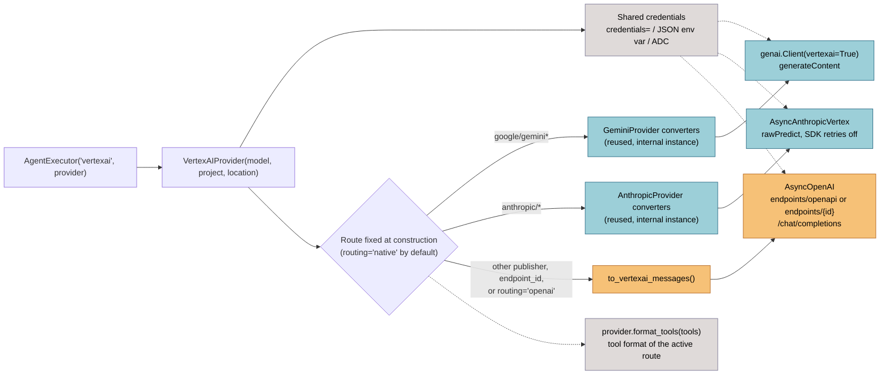
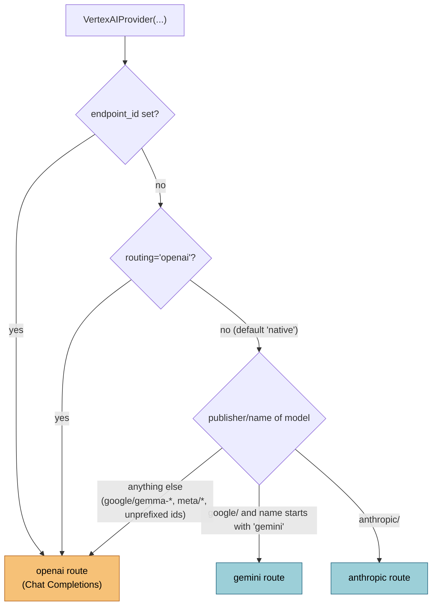
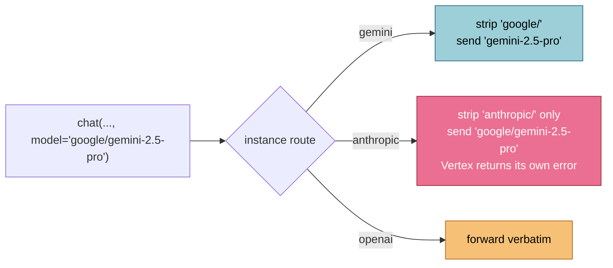
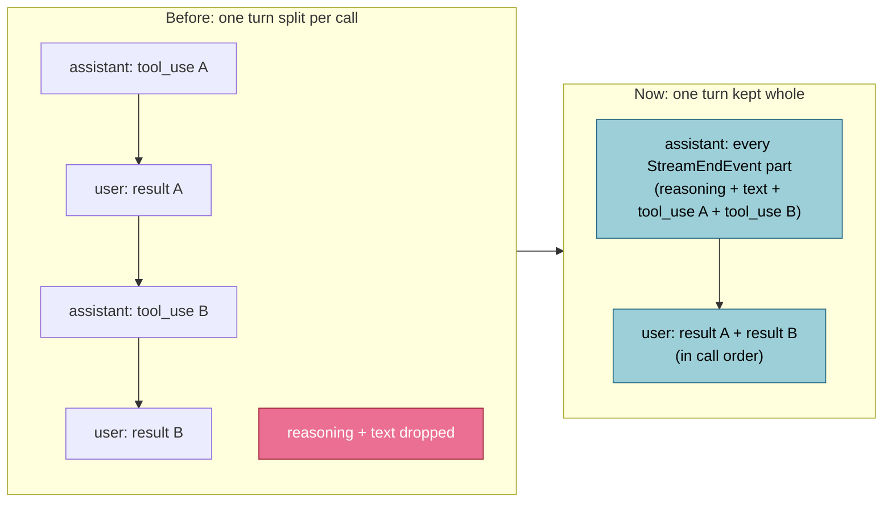
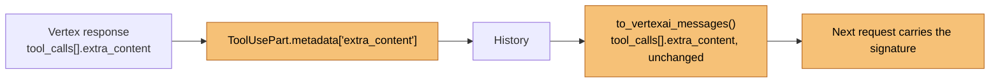
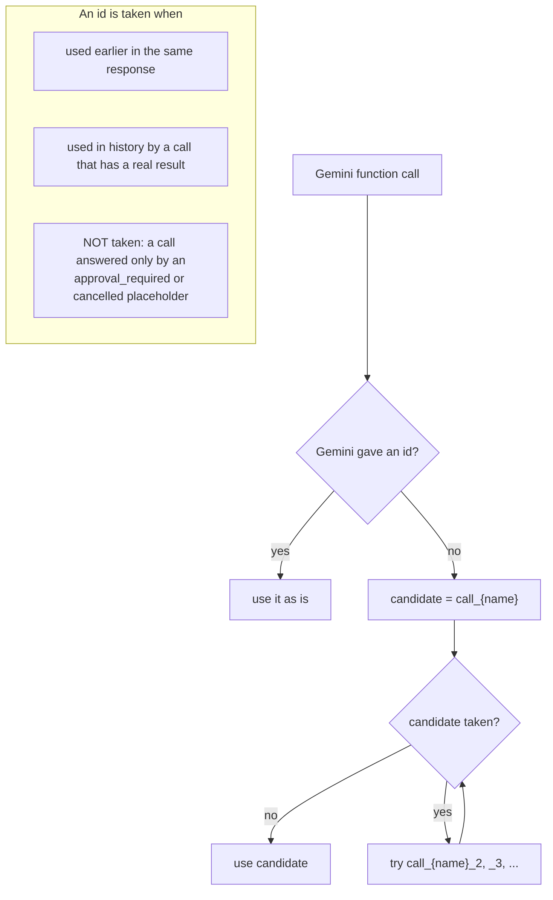

# Vertex routing

How `VertexAIProvider` sends a request to Vertex AI, shown as diagrams. The prose
reference is [providers/vertexai.md](./providers/vertexai.md).

`VertexAIProvider` is one entry point that routes by publisher. It holds one set of
Google credentials, picks a route from the instance model at construction, and
sends each request over that route:

- `google/gemini*` goes to Gemini's native API.
- `anthropic/*` goes to the Anthropic Messages API on Vertex.
- Everything else, and every self-deployed endpoint, goes to Vertex's
  OpenAI-compatible Chat Completions endpoint.

Legend used in the diagrams:

- Blue: native protocol (one translation, nothing lost)
- Orange: OpenAI-compatible protocol (Google translates again on its side)
- Grey: shared between routes

---

## Request flow

- All routes share the resolved credentials, project and location.
- Dobby's `with_retries` is the only retry layer on every route.
- `provider.name` is `"vertexai"` and `provider.model` is the id as passed, on
  every route. `provider.client` is the `AsyncOpenAI` client; the native routes
  use their own SDK clients.

---

## How the router picks a route

The route is chosen once, from the instance model, and reads the publisher only.
Nothing is validated against a model list.

A per-call `model=` override is always sent over the instance's route:

---

## History batching

`AgentExecutor` keeps each tool turn whole on every route. Events are unchanged;
only the history the executor builds for the next request changes.

Hosts that persist history should store it in the same shape: `StreamEndEvent.parts`
as one assistant message and every tool result as one user message. Old split-shape
histories are still accepted.

---

## Gemini thought signatures on Chat Completions

On the OpenAI-compatible route, Vertex returns Gemini thought signatures on
`tool_calls[].extra_content`. The provider keeps them and sends them back.

Missing, empty or non-dict values are dropped rather than replayed.

---

## Gemini tool-call IDs

Gemini often returns function calls with no ID. Dobby mints one per call.

- A single call to a tool keeps `call_{name}`, as before.
- A call paused for approval keeps its ID when the model regenerates it, so it
  still matches the host's `approved_tool_calls`.
- A later, separate call to the same tool gets a suffix, so it cannot reuse an
  earlier approval.
